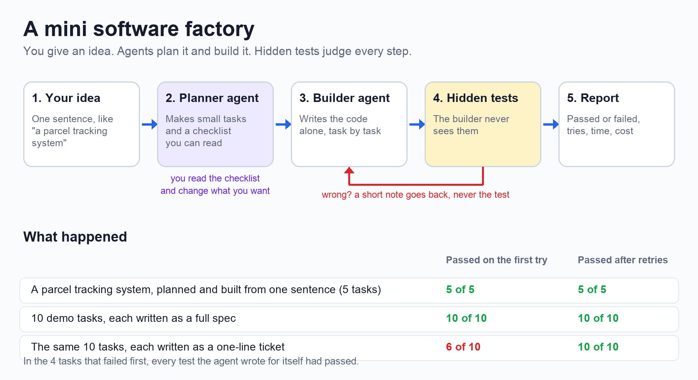

# AI mini software factory

A small software factory you can run on a laptop. You give it an idea. A planner agent breaks it into small
tasks, builder agents build them alone, and hidden tests judge every step.



## What this is

This is a **starting idea**, not a finished product. It shows, in one small file, how a software factory works, so
you can understand it and build your own on top of it.

- It builds the **backend logic** of a product: the rules and the data, in plain Python.
- It is made for **small, simple things**: a tracking system, a booking system, a price calculator.
- It does not build screens, websites or apps.

If you want more, the part "Take it further" below shows where to add it.

## The problem

Everyone is talking about "software factories": AI agents that take a task and build it without a person typing
each step.

The hard part is not getting an agent to write code. The hard part is knowing if the code is right when nobody
reads it.

- An agent writes its own tests. They pass. It says "done".
- But its tests only check what the agent thought of.
- So work can look finished and still be wrong.

## What this tool does

It is a factory in one file, small enough to read in ten minutes.

1. **A task goes in.** A short text, like a ticket.
2. **An agent builds it alone**, in its own fresh copy of a small shop project.
3. **Hidden tests judge it.** The agent never sees them.
4. **If something is wrong, a short note goes back**, like "an empty cart must have no shipping cost". Never the
   test itself. The agent gets 3 tries at most.
5. **A report comes out:** passed or failed, tries, time and cost.

## Start your own product

You do not need the demo. Give the factory your own idea, in one sentence.

**1. Tell it your idea**

```bash
uv run factory.py start "an online parcel tracking system" --name parcel-tracking
```

A planner agent breaks the idea into 5 small tasks. This is what it made for the tracking system:

```
01-core-parcel-registry:   register a parcel and get a tracking number
02-add-status-updates:     add status updates with a place and a time
03-customer-lookup:        look up a number: current status and full history
04-lock-delivered-parcels: no more updates after a parcel is delivered
05-shop-parcel-list:       a shop lists its parcels, with a filter on status
```

**2. Read the checklist, and change what you do not want**

For every task the planner writes the hidden tests, and a `checklist.md` that says in plain words what they check.
No code reading needed:

```
- After an update the parcel status must be the new status.
- History must be sorted oldest first.
- An unknown tracking number must raise KeyError.
- A bad status or empty place must be refused, and nothing must be stored.
```

"Hidden" means hidden from the agent that builds, not from you. This is the step where you decide what "right"
means. The planner is an AI, so read its list.

**3. Build it**

```bash
uv run factory.py build products/parcel-tracking
```

The agents build task by task. Each one starts from the work of the one before. After every task, the hidden
tests of all tasks so far run again, so a new task cannot quietly break an old one.

For the tracking system: 5 of 5 tasks passed, in 119 seconds, for $0.84 at API prices. The result is in
[`products/parcel-tracking`](products/parcel-tracking/): the plan, the checklists and the finished code.

## What else you can use it for

| You want to | Do this |
|---|---|
| **Understand how a software factory works** | Read `factory.py`. It is one file. Then run one task and watch the agent work. |
| **See how good your tickets are** | If an agent fails on the first try, the ticket left something out. See "What I found" below. |
| **Compare AI models** | Run the same ten demo tasks with two models and compare passes, time and cost. |
| **Work on code you already have** | Point it at your own Python project with `--project`. |

## What you get

While it runs, you see every step the agent takes:

```
Task 06-shipping
  try 1: agent is working ...
      agent reads shop/cart.py
      agent reads tests/test_cart.py
      agent changes shop/cart.py
      agent changes tests/test_cart.py
      agent runs: python3 -m pytest -q
    tests the agent can see: 5 passed, 0 failed
    hidden tests:            4 passed, 3 failed
  try 2: agent is working ...
      agent changes shop/cart.py
      agent changes tests/test_cart.py
      agent runs: python3 -m pytest -q
    tests the agent can see: 8 passed, 0 failed
    hidden tests:            7 passed, 0 failed
```

At the end, one table (also saved as `out/report.md`):

| Task | Result | Tries | Time | Cost (API price) |
|---|---|---|---|---|
| 05-sales-tax | Passed | 1 | 27 s | $0.18 |
| 06-shipping | Passed | 2 | 41 s | $0.30 |
| 07-receipt | Passed | 1 | 32 s | $0.08 |

For every try, four files are saved in `out/logs/<task>/`:

| File | What is in it |
|---|---|
| `try-1-agent.txt` | What the agent was told, every step it took, and what it said at the end |
| `try-1-change.diff` | The exact lines the agent added and removed |
| `try-1-visible.txt` | The result of the tests the agent can see |
| `try-1-hidden.txt` | The verdict of the hidden tests |

## What I found

The project comes with a demo: 10 small tasks on a tiny shop cart. I ran them twice. The only difference was how
the task was written.

| How the task was written | Passed on the first try | Passed after retries | Time | Cost (API price) |
|---|---|---|---|---|
| A full spec, every rule written out | 10 of 10 | 10 of 10 | 213 s | $1.60 |
| A one-line ticket | 6 of 10 | 10 of 10 | 284 s | $2.08 |

In the 4 tasks that failed first, **every test the agent wrote for itself had passed**:

| Task | The agent's own tests | Hidden tests | What was really wrong |
|---|---|---|---|
| Refuse bad input | 18 passed | 1 failed | A quantity like 1.5 was accepted |
| Merge same items | 5 passed | 2 failed | The same item at a different price was accepted |
| Shipping | 5 passed | 3 failed | Shipping was not added to the total, and an empty cart was charged |
| Save and load | 5 passed | 4 failed | Broken saved data was not refused |

After one short note for each wrong point, all four passed on the second try. No person was needed.

What I take from it:

- A short ticket costs a retry. Time and cost went up by about a third.
- An agent's own tests are not proof.
- A hidden judge and a short note are enough to fix small mistakes.

The full results are in [`results/`](results/).

## How to use it

### Step 1: Install two things

- **uv**, which runs the tool: [install uv](https://docs.astral.sh/uv/getting-started/installation/)
- **Claude Code**, the AI agent: [install Claude Code](https://code.claude.com/docs). Then type `claude` in a
  terminal once and sign in with your Claude account.

### Step 2: Download this project

```bash
git clone https://github.com/muhammadrao1988/ai-mini-software-factory.git
cd ai-mini-software-factory
```

### Step 3: Start your own product

```bash
uv run factory.py start "your idea in one sentence" --name my-product
uv run factory.py build products/my-product
```

Between the two commands, read `task.md` and `checklist.md` in each folder of `products/my-product/tasks/`.

### Or: run the demo

```bash
uv run check_tasks.py                # proves the hidden tests of the demo are fair (no AI, a few seconds)
uv run factory.py tasks/01-discount-code
uv run factory.py tasks              # all ten, each as a full spec
uv run factory.py tasks --tickets    # all ten, each as a one-line ticket
```

### Or: work on code you already have

Your project must be a Python project with a `tests/` folder. Make a task folder with a `task.md` and your
hidden tests in `hidden/test_hidden.py`, then:

```bash
uv run factory.py my-tasks/add-login --project path/to/your/project
```

The agent works on a copy. Your project is never changed. The change is saved in `out/logs/`.

### No Claude subscription? Use an API key

An API key is a paid key from Anthropic. Create one in the [Claude Console](https://platform.claude.com/), then:

```bash
export ANTHROPIC_API_KEY=sk-ant-...
uv run factory.py tasks --api-key
```

Without `--api-key`, the factory uses your Claude sign-in and ignores any API key, so you never get a bill by
accident. A full run of ten tasks costs about $2 at API prices.

## Take it further

The factory is one file, so every part is easy to find and change.

| You want | Where to change it in `factory.py` |
|---|---|
| A web API or screens on top of the logic | Change the planner's rules (`PLANNER`): allow a web framework and say how the tests call it |
| Another language than Python | Change the planner's rules and the judge (`pytest`), which runs the tests |
| A real database | Change the planner's rules; give the judge a test database |
| Bigger products | Raise `--tasks`, or run `start` again for the next part of the product |
| Several agents at the same time | `build` runs tasks one by one; tasks that do not depend on each other could run side by side |
| Tasks from GitHub issues, results as pull requests | Replace the task folders (`start`) and the last step of `build` |
| A stricter judge | Add your own tests to `hidden/` before you build |

The three parts stay the same in any size of factory: someone plans, someone builds, and a judge that the builder
cannot see decides.

## A lesson from building it

On my very first run, the judge was wrong, not the agent. It failed a correct answer, and the agent spent two more
tries fixing a problem that did not exist.

So the judge now works in a clean copy and saves a log of every verdict, and `check_tasks.py` tests the judge
itself before any agent runs. A factory is only as good as its judge.

## Good to know

It never publishes or merges anything by itself. It stops at the report, and a person decides what happens next.

<details>
<summary>More details: the files, writing your own task, settings</summary>

**The files**

| File or folder | What it is |
|---|---|
| `factory.py` | The factory: workspace, agent, judge, retry, report |
| `check_tasks.py` | Tests the judge itself, without AI |
| `products/` | Your products. `parcel-tracking` is the worked example |
| `demo/` | The small shop project for the demo tasks |
| `tasks/<name>/task.md` | The task as a full spec |
| `tasks/<name>/ticket.md` | The same task as one line |
| `tasks/<name>/hidden/` | The hidden tests. The first line of text in each test is the note the agent gets on a fail |
| `reference/` | A correct answer for each task, written by hand, used only by `check_tasks.py` |
| `results/` | The results and judge logs of my runs |

**Write your own task**

1. Make a folder in `tasks/` with a `task.md` and a `ticket.md`.
2. Put tests in `hidden/test_hidden.py`. Give each test a first line of text that says, in plain words, what must
   be true.
3. Put a correct `cart.py` in `reference/<task name>.py`.
4. Run `uv run check_tasks.py`.

**What the agent is allowed to do**

Read, write and search files in its own folder, and run the tests. Its folder is a temporary copy outside this
project, so the tasks, the hidden tests and the reference answers are not in it.

**Smaller notes**

- The agent is kept in its folder by Claude Code's permission rules.
- The hidden tests show what I think is right for each task.
- Tested on a Mac. `start` and `build` were run on one idea so far, the parcel tracking system. The `--api-key`
  option is not yet run with a paid key.
- A product is built and tested with the Python that runs the factory (3.14 for me). Its README says which.

**Settings**

| Setting | Default | What it does |
|---|---|---|
| `--name` | `my-product` | `start`: the name of your product folder |
| `--tasks` | `5` | `start`: how many tasks the planner makes |
| `--tickets` | off | Give the agent `ticket.md` instead of `task.md` |
| `--project` | the demo shop | Demo-style tasks only: the Python project the agents work on |
| `--api-key` | off | Pay with `ANTHROPIC_API_KEY` instead of the Claude sign-in |
| `FACTORY_MODEL` | `sonnet` | The AI model the agent uses |

</details>

Built by [Muhammad Rao](https://github.com/muhammadrao1988) with Claude Code. MIT licence.
